# 石器时代 H5 使用手册

本手册面向两种读者：**架设服务端的人**（第 1～3 章）与**玩家**（第 4 章起）。
第 20 章是开发者附录。项目本身只用于学习与研究，不兼容原版的线路协议，也不兼容原版 Windows 客户端。

目录

1. [简介与系统需求](#1-简介与系统需求)
2. [安装与启动](#2-安装与启动)
3. [服务端设定 config.yaml](#3-服务端设定-configyaml)
4. [账号与角色](#4-账号与角色)
5. [画面与操作](#5-画面与操作)
6. [地图与移动](#6-地图与移动)
7. [聊天](#7-聊天)
8. [NPC](#8-npc)
9. [战斗](#9-战斗)
10. [道具](#10-道具)
11. [宠物](#11-宠物)
12. [咒术（精灵）](#12-咒术精灵)
13. [社交：组队、交易、摆摊、名片与邮件、决斗、动作](#13-社交)
14. [家族与庄园](#14-家族与庄园)
15. [任务](#15-任务)
16. [交通：长毛象巴士与加美航空](#16-交通长毛象巴士与加美航空)
17. [设定与存档](#17-设定与存档)
18. [GM 指令](#18-gm-指令)
19. [与原版不同的地方与常见问题](#19-与原版不同的地方与常见问题)
20. [开发者附录](#20-开发者附录)

---

## 1. 简介与系统需求

石器时代 H5 是用原客户端的美术、音乐与原版服务端数据，按原客户端 / 原服务端的逻辑重新实现的 **HTML5 客户端 + Go 服务端**。
玩家只要有浏览器就能玩，不用安装任何东西。

| | 需求 |
|---|---|
| 服务端 | Windows / Linux / macOS 都可以；一个可执行文件 `saserver`，用 SQLite 存档，不需要另装数据库 |
| 玩家 | 支持 WebGL2 的浏览器：Chrome / Edge / Firefox 近几年的版本都可以；Safari 有些版本放不了 Ogg Opus 音频（画面正常、没有声音） |
| 网络 | 一个 TCP 端口（预设 8800），页面、资源与游戏连线（WebSocket）都走它 |
| 磁盘 | 资源目录 `assets/` 约 0.9 GB |

---

## 2. 安装与启动

### 2.1 目录

```
（仓库根目录）
  bin/saserver.exe   服务端（Linux / macOS 是 saserver）；运行时在旁边建立 saserver.db
  config.yaml        设定档（见第 3 章）
  config.local.yaml  本机覆盖用的设定（可以没有；不进版本库）
  assets/            美术与音频（WebP 图集、动画、Opus 音频）
  gamedata/          原版服务端数据（地图、NPC、道具、敌人……）
  client/            网页客户端（index.html 与 dist/）
  docs/              本手册与截图
```

整个目录带走就能运行，不依赖目录以外的东西。

### 2.2 启动

在根目录下直接执行：

```bash
bin/saserver.exe
```

没有命令行参数，设定全在 `config.yaml`（先找当前目录，再找执行档上一层）。
启动后用浏览器打开 `http://127.0.0.1:8800/`（端口看 `addr`）。

第一次启动会建立 `bin/saserver.db`；删掉它就是清空所有账号、角色与家族。

### 2.3 让别人连进来

1. `config.yaml` 的 `addr` 改成 `0.0.0.0:8800`（或别的端口），防火墙开放那个端口。
2. **对外开放时一定要配 TLS**：`tlsCert` / `tlsKey` 填 PEM 证书与私钥的路径，服务端就改用 HTTPS / WSS；没有 TLS 的话账号密码在网络上是明文，服务端启动时会在日志里提醒。
3. 如果客户端页面放在别的网域（例如前面有一层反向代理用了别的网址），把那个来源写进 `origins`，否则 WebSocket 会被拒绝。

### 2.4 从源码构建（可选）

需要 Go 1.22+ 与 Node 22+（客户端构建用 Node 自带的去类型功能，不依赖 npm）：

```bash
cd server && go build -o ../bin/saserver.exe ./cmd/saserver
cd .. && node client/build.mjs
```

资源导出（从原客户端的 real / adrn / spr / pal 产生 `assets/`）见 `CLAUDE.md` 的"重新导出 assets"。

---

## 3. 服务端设定 config.yaml

相对路径以设定档所在的目录为准。同目录的 `config.local.yaml` 里写的项目会盖掉 `config.yaml` 的同名项目，本机开发用它写 GM 账号等，不用改主设定。

| 项目 | 说明 | 预设 |
|---|---|---|
| `addr` | 监听地址 | `127.0.0.1:8800` |
| `data` / `assets` / `client` / `db` | 数据、资源、客户端页面、SQLite 的路径 | `gamedata` / `assets` / `client` / `bin/saserver.db` |
| `origins` | 额外允许连 WebSocket 的页面来源 | `[]`（只允许同源） |
| `gms` | GM 的**账号名**（登录账号，不分大小写，可以多个）。这些账号名在注册时保留给管理员，删库重建后别人抢不走；开机时还没注册的会在日志里提醒 | `[]` |
| `groups` | 大区与线路。每条线路是一个独立世界（各自的地图、NPC、玩家），账号、角色与家族所有线路共用 | 一个大区三条线路 |
| `log` | 日志等级 debug / info / warn / error | `info` |
| `tlsCert` / `tlsKey` | PEM 证书与私钥，给了就用 HTTPS / WSS | 空 |
| `maxChars` | 每个账号的角色位（2..8），超过 2 时选人物画面会分页 | `2` |

`rules` 是游戏规则，没写的项目用原版的值，开机时检查范围：

| 项目 | 说明 | 预设 |
|---|---|---|
| `expRate` | 战斗经验倍率 | 1 |
| `shareExp` | 经验共享（见 9.8）：战斗结束时还在场的人物、出战宠物、骑宠拿一样多的经验；false 是原版的谁打倒谁拿 | true |
| `dropRate` | 战利品机率倍率 | 1 |
| `encounterRate` | 遇敌机率倍率（0 不会遇敌） | 1 |
| `turnTime` | 每回合选指令的秒数（5..300） | 30 |
| `levelUpPoints` | 人物每升一级的加点 | 3 |
| `groundItem` / `groundPet` / `groundGold` | 丢在地上的道具 / 宠物 / 石币几秒后消失 | 20 / 30 / 1800 |
| `familyFee` | 成立家族的手续费 | 10000 |
| `noEscapeFloors` | 在这些楼层按逃跑会被改成防御（原版 NOTESCAPE） | 原版的清单 |
| `worldTrans` / `worldLevel` / `worldFame` | 世界频道要几转、几级，每句扣多少声望（内部值，100 = 显示的 1 点） | 5 / 140 / 1 |
| `busStep` | 长毛象巴士 / 加美航空每走一步的毫秒数（100..2000，越小越快） | 300 |
| `vendorTax` | 摆摊卖出时抽的税（百分比，0..100） | 0 |
| `walkSpeed` | 走路速度倍数（0.25..4；服务端的步频限制与客户端的步长一起缩放，只管地图上走路） | 1 |
| `battleSpeed` | 战斗演出的速度倍数（0.25..4；走过去、走回来与攻击等动作动画一起加速，回合时限与结算不变） | 1 |
| `enemyGuardRate` | 敌人选"防御"的机会倍率（0..1；1 是原版，0 敌人不防御） | 0.5 |
| `petDeathLoss` | 出战宠物在对敌人的战斗里倒下时扣掉几级的成长（0..10；每项基本状态扣 (成长率 + 2.5) × 档次倍率 × 这个数；决斗不算；0 不扣，原版只扣忠诚度） | 0 |

改了设定要重启服务端。

### 3.1 账号安全

- 密码至少 8 位（客户端检查）。密码在浏览器里先算成 MD5 再送出，服务端只存、只比对这个 MD5：服务端与数据库里没有明文密码。
  但 MD5 本身没有加盐，拿到数据库的人可以用彩虹表反推常见密码，拿到传输内容的人也能直接用那个 MD5 登录，所以对外开放时仍然要配 TLS。
- 登录 / 注册连续失败 5 次锁 1 分钟，之后每次加倍到 1 小时（按来源 IP 与账号名各算）；找回密码时安全码连错 5 次同样锁住；一个 IP 一小时最多注册 5 个账号。
- 同一角色在别的线路或别的浏览器登录，旧连线会被踢下线（顶号）。
- 世界里的发言有速率限制（一次 4 句，之后每秒 1.5 句）。

---

## 4. 账号与角色

### 4.1 登录与注册

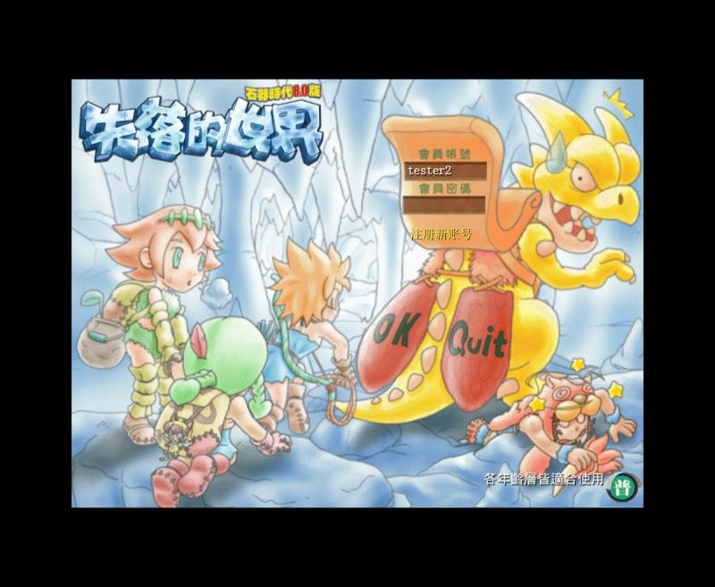

登录页输入账号与密码。原版要到官网注册，这里直接在登录页按"注册新账号"，填账号（3–16 位字母、数字、下划线）、密码（8–64 位）、确认密码与**安全码**（4–32 位）。
安全码是找回密码用的，请记好。忘记密码时按登录页的"找回密码"，填账号、安全码与新密码即可；安全码连错几次会暂时锁住（和登录一样，每次加倍）。
改版前注册、没有安全码的账号不能找回，只能请管理员处理。

### 4.2 线路与角色

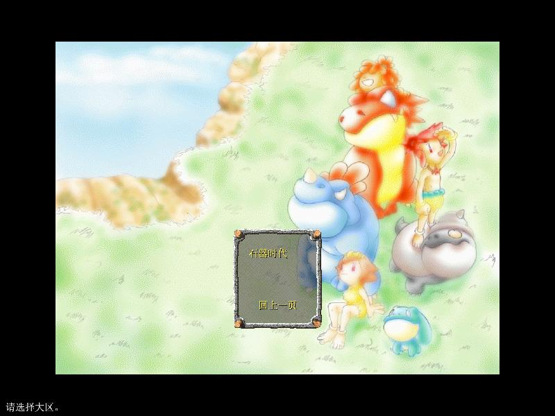

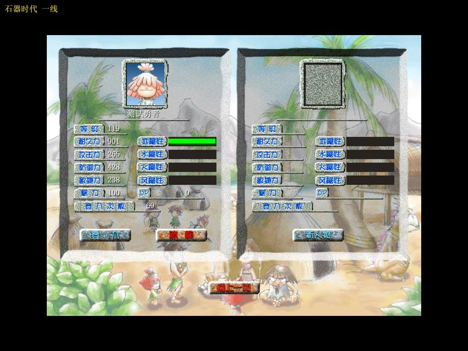

登录后选大区与线路（线路名旁显示在线人数）。每条线路是独立的世界，但账号、角色、家族共用：同一个角色可以到任何一条线路玩，家族成员分布在不同线路也能用家族频道。

选人物画面显示每个角色的头像、各项数值、四属性与登入次数；可以建立、删除角色（在线上的角色不能删）。角色位超过 2 个时画面两侧有翻页箭头。

### 4.3 建角

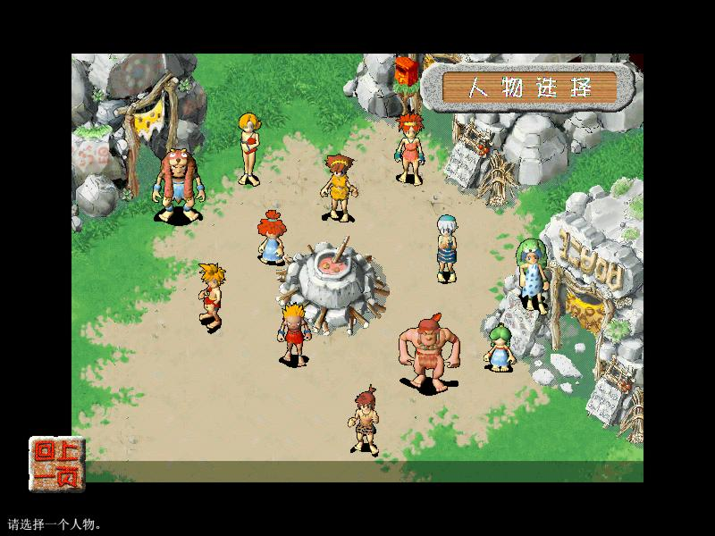

三步：

1. 选形象与颜色（12 种人物 × 4 种颜色）。
2. 姓名、长相（头像与形象对应）、基本状态 20 点（体力 / 腕力 / 耐力 / 敏捷）、属性 10 点（地水火风正好 10 点、最多两种、相克的不能同时选：地克风、水克火）。
3. 选出身地：萨姆吉尔、玛丽娜丝、加加、卡鲁它那。

角色名只能用字母（含中文）与数字。

---

## 5. 画面与操作

画面是 800×600（4:3），按浏览器窗口等比缩放、不出卷轴，按屏幕实际像素渲染（高分屏也清晰）。

### 5.1 布局

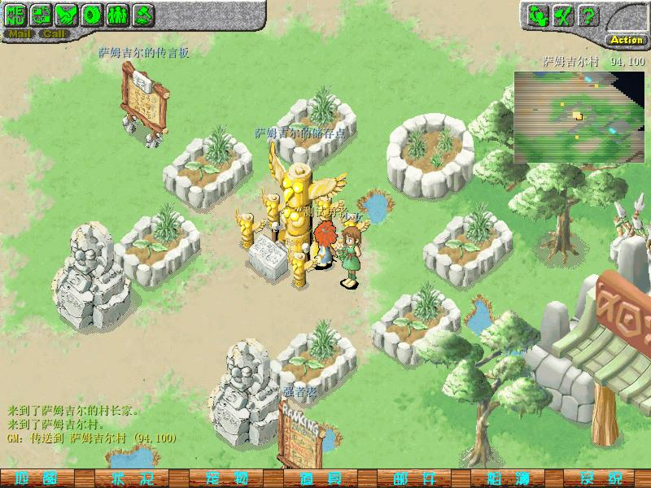

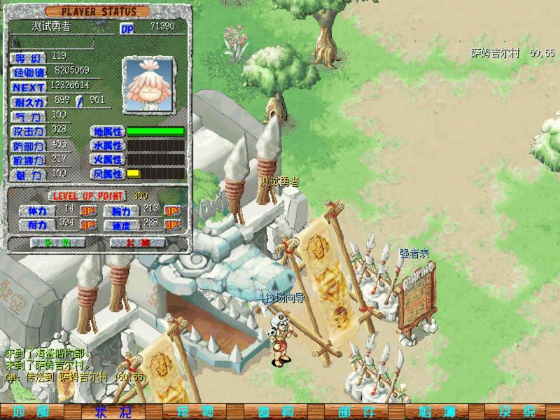

- **画面上方左边**：设定（游戏设定 Ctrl+Q）、名片、组队、交易、家族、摆摊；有新邮件时灯会闪。
- **画面上方右边**：参战、决斗、动作、任务查询。
- **右上角**：楼层名与座标，下面是追踪中的任务。
- **左下角**：聊天栏（按 Enter 输入），再下面一行是说明文字（滑鼠停在按钮上会写用途）。
- **最下方任务栏**（常驻，原版要把滑鼠移到底部才升起）：地图、状态、宠物、道具、邮件、相簿、系统。
- **状态窗口**右上角的"详细"钮：在旁边列出攻防敏耐久的本身值与装备加减、会心与回避、属性、声望、本级经验还差多少、智慧之果、骑乘等级、魔法熟练度与抗魔。

有窗口开着时画面上方的按钮不画。状态、宠物、系统、任务、相簿窗口互斥（开一个关其他），道具窗口和地图窗口互斥。

### 5.2 滑鼠

| 操作 | 作用 |
|---|---|
| 左键点地面 | 走过去（照原版直线走法，绕不过去时自动寻路） |
| 左键点 NPC | 走到旁边并对话 |
| 按住左键 1 秒 | 进入跟随模式：角色不断朝光标所在的格子走，再点一下退出 |
| 右键点身边一格 | 那一格有地上的东西就捡起来，否则转身面向那边 |
| 右键点道具栏的道具 | 做加工 / 料理 / 精炼等的标记（见 10.6） |
| 双击道具 | 使用 / 装备 / 卸下 |

### 5.3 快捷键

| 键 | 作用 |
|---|---|
| 方向键 | 走路（队员时只转身） |
| Enter | 输入聊天 |
| Esc | 系统窗口（也关掉当前窗口） |
| Ctrl+S | 状态窗口 |
| Ctrl+I | 道具窗口 |
| Ctrl+P | 宠物窗口 |
| Ctrl+M | 世界地图 |
| Ctrl+E | 名片与邮件 |
| Ctrl+A | 宠物图鉴（相簿） |
| Ctrl+W | 动作窗口 |
| Ctrl+Q | 游戏设定（组队 / 决斗 / 名片 / 交易 / 频道开关） |
| Ctrl+T | 向面前的人提出交易 |
| PageUp / PageDown | 开关自动战斗 |
| Ctrl+1～0、Ctrl+-、Ctrl+=、Ctrl+\ | 动作：1 坐下 2 挥手 3 点头 4 高兴 5 生气 6 悲伤 7 站立 8 走动 9 晕倒 0 攻击，- 防御 = 受伤 \ 投掷（站着不动时才有效） |

网址后加 `?debug` 显示帧率、每帧耗时、SA 时间等调试信息，第二行是最近 2 分钟和服务端往来的平均消息数（msg/s）与流量（KB/s，压缩前）。

---

## 6. 地图与移动

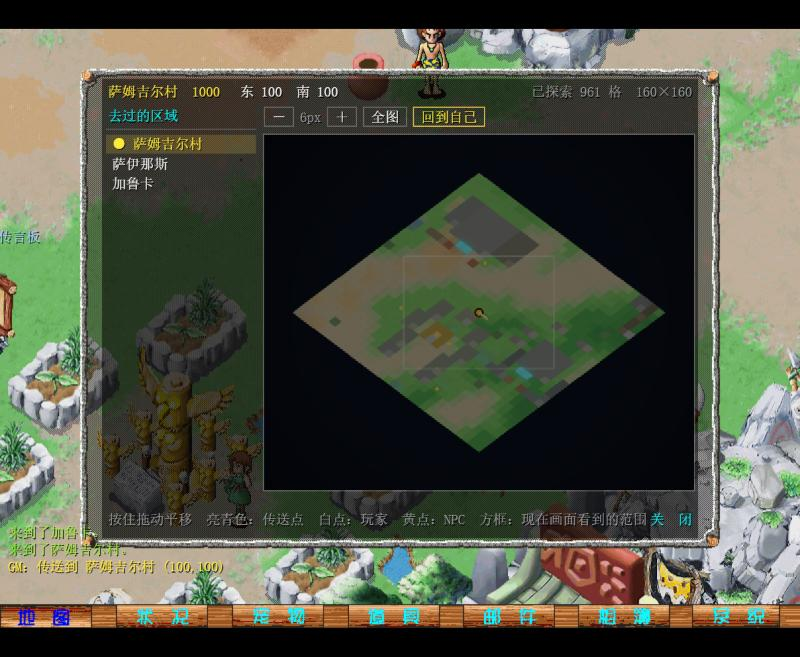

- 1370 张原版地图，通行规则、传送点都照原版。走到传送点自动传送；楼层名显示在右上角。
- 地图窗口预设用地块与建筑的图画出看过的地方（工具列"实景"，关掉是色块），右上角的小地图也一样。
- **昼夜**：按游戏时间（一个 SA 日 = 现实 90 分钟）切换调色板，早晨、白天、傍晚、夜晚的画面颜色不同；部分 NPC 只在某个时段出现。
- **记录点**：和各村的长老 / 记录点 NPC 说话登记；系统窗口的"回记录点"传回最后登记的地方（战斗中、带着货物、组队去天空之岛时不能用）。
- **世界地图**（Ctrl+M / 任务栏"地图"）：
  - 标题列是楼层名 / 编号、自己的座标、已探索格数与楼层大小；
  - 左边"去过的区域"列出去过的楼层，点一层就看那一层（没去过的不显示）；
  - 工具列：－ / ＋ 缩放（每格 2～16 像素）、"全图"按看过的范围缩放居中、"回到自己"（回自己那层并跟着自己移动，拖动地图就不跟了）、
    "小地图"（在画面右上角常显一张跟着自己的小地图，中央金点是自己、短线是朝向，设定会记住）；Esc 或"关闭"关窗口；
  - 点自己这一层地图上走过的格子就自动寻路走过去（只会经过看过、能走的格子，远一点的目标也行）；
  - 地图按住拖动平移；只画自己走过看过的格子，传送点亮青色，白点是视野内的玩家、黄点是这一层全部的 NPC（滑鼠停上去显示名字，看别层的地图也有）、
    金色呼吸点是自己、方框是现在画面看到的范围。
  - 看过的格子存在浏览器里，换浏览器或清资料就要重新探索。

---

## 7. 聊天

密语：在聊天栏打 `/tell 名字 内容`，只有那个人（同一线路）看得到；对方在游戏设定（Ctrl+Q）里关了"密语频道"就送不到。Ctrl+R 把上一个密语你的人填进输入行。

频道：输入行左边的频道钮或 Tab 轮换 附近 → 队伍（组队时）→ 家族（有家族时）→ 世界 → 星球；世界与星球要在游戏设定里开着。星球频道是所有线路都收得到的广播（要 5 转 140 级、每句扣 1 点声望，可在 config 的 rules 调），颜色随机。

聊天栏保留 200 行，右下角的 ▲ ▼ 往前后翻、● 回到最新，最上面的 ◆ 打开完整的聊天记录窗口（滚轮翻页，Esc 关闭）；输入行里 ↑↓ 翻最近 64 句说过的话。"对话储存"开着时记下聊天栏的讯息，关掉时存成一个文字文件下载。

心情图示：Alt + Q W E R T Y U I O P A S D F G H J 在头上冒出爱心、心碎、剪刀、石头、布、尖叫、问号、青筋、乌云、汗、沉默、睡觉、咖啡、灯泡、强调、钱、PK；睡觉、咖啡、强调会留在头上。

F11 开关头顶名字（地图上别人的名字、战斗里全部人的名字），F12 把画面存成 PNG 下载。鼠标停在别的玩家身上，底行显示家族、名字与等级。

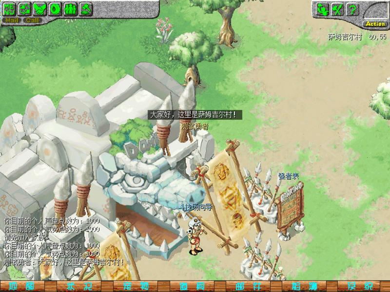

按 Enter 输入，再按 Enter 送出。聊天栏左下角的 `[附近]` 钮切换频道：

| 频道 | 说明 |
|---|---|
| 附近 | 范围照原版：聊天设定里的"音量"加句末 `!` 的个数决定传多远；以 `...` 结尾是悄悄话（只有面前的人听到） |
| 队伍 | 组队中的队员 |
| 家族 | 家族成员（所有线路）；族长开着广播时族长的话所有族人都看到 |
| 世界 | 要 5 转 140 级（可在 rules 调），每句扣 1 点声望，两句间隔 5 秒以上 |

- 文字颜色在系统窗口 → 聊天设定里选；对着 NPC 说特定的话会触发剧情（传送员的暗语、任务交换的关键字、店员的"买 / 卖"）。
- 聊天里说"坐下""挥手"等动作名会做出动作。
- 游戏设定（Ctrl+Q）里可以关掉"频道"开关，就看不到世界频道。

---

## 8. NPC

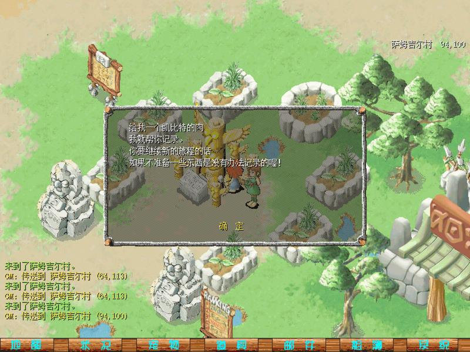

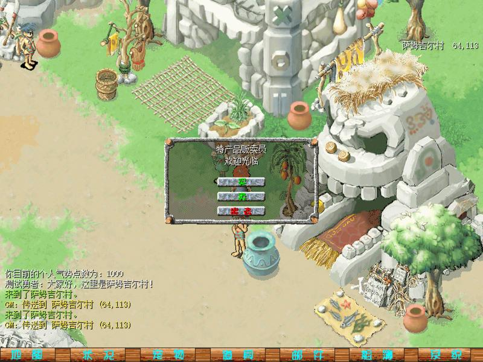

走到 NPC 旁边点它（或面向它说话）。2156 个原版 NPC 都在，常见的几种：

| NPC | 用法 |
|---|---|
| 村民、告示牌 | 随机说原版台词；告示牌弹窗显示全文 |
| 护士 | 回复耐久力 / 气力 / 宠物；等级到了收费（等级 × 单价），宠物回复免费 |
| 传送员 | 按条件免费或付费传送；有的要门票、有的要对着它说暗语；组队中不能用 |
| 万事通 | 翻页的说明窗口 |
| 记录点 | 第一次要交出指定道具才登记，之后说话就把记录点设在这里 |
| 道具店 | 买卖选单 → 清单（每页 8 项，等级不够标红、买不起标灰，滑鼠停留看说明）→ 个数 → 确认；家族商店的声望价道具要扣声望 |
| 寄放道具的店 | 每件收费寄放，最多 30 件；登出消失的道具不收 |
| 宠物店 | 卖宠物、寄放（50 + 等级×4 石币）、领回 |
| 宠物技能店 | 技能清单 → 选宠物 → 选技能栏 → 确认 |
| 传言板 | 看最新留言、翻页、写留言（所有线路共用） |
| 美容师 | 魅力 +5，收费按等级与魅力 |
| 占卜师 | 付钱后按今天的运气说一句 |
| 猜拳道场 | 收参加券后猜拳，赢了上一层、输了退一层 |
| 猜谜 | 二选一 / 三选一用选单，写答案用输入行 |
| 道具兑换 | 宝石提炼等 |
| 麦克风 | 对着它说话，同一楼层范围内的人都收到黄字广播 |
| 任务交换 | 接任务 / 交任务 / 说明；有的要对着它说关键字（见第 15 章） |
| 战斗 NPC | 道场弟子、魔王、守门的敌人：说话（或走到它身上）后按条件问要不要战斗 |
| 骑乘训练师 | 四个家族村庄：骑乘课程、骑乘证书 |
| 决斗强者表 | 看 DP 排名 |
| 家族管理员、家族留言版、家族银行、庄园的秘书与小护士 | 见第 14 章 |
| 长毛象巴士、加美航空 | 见第 16 章 |
| 庄园争夺战 / 家族 PK 场的踢馆登记人、场地预约人、对战向导、召唤员、服务员 | 见 14.5 |

---

## 9. 战斗

### 9.1 遇敌

在野外每走一步按区域的遇敌率判定；遇敌后切到战斗画面（快速战斗时不切；观战与玩家决斗一定看画面）。驱魔道具约 6 分钟不遇敌，诱魔道具原地遇敌。

### 9.2 回合

一场战斗开打 60 分钟后，回合时限到了还没下指令的人会被请出战斗（"时间到，结束战斗。"），其他人继续。

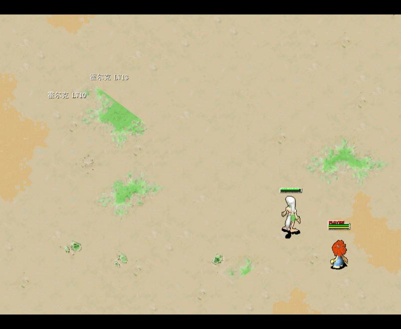

每回合 30 秒（可调）选指令，按速度排序行动：

| 按钮 | 作用 |
|---|---|
| 攻击 | 点选目标 |
| 防御 | 减伤（随机剩 10%～50%，至少 1 点；原版有 25% 机会完全挡掉，这里改成不会完全格挡） |
| 逃跑 | 机率照原版；NOTESCAPE 楼层会被改成防御；头目战逃不了 |
| 精灵 | 装备上的咒术，按咒术的目标种类选人（单人 / 一排 / 一边 / 全体） |
| 道具 | 战斗中能用的道具（回复、状态、捕获之果、复活……） |
| 捕捉 | 选一个敌人，机率照原版（敌人 HP 越少越好抓；比自己高 5 级以上、宠物栏满、需要道具的敌人抓不到） |
| 换宠物 | 叫出待命的宠物或只收回在场的（新宠物下回合才行动） |
| 求救 | 头上出现求救记号，别人面向你按"参战"就加入（见 9.6） |

人下完指令后宠物面板滑入，选技能与目标（上回合的技能沿用）。

闪避、会心、防御减伤、属性相克、反击、连击、偷袭、守护、异常状态（毒 / 麻 / 眠 / 石 / 醉 / 乱、虚弱、剧毒、魔障、沉默）、战场属性、骑宠分摊伤害与落马都照原版。敌人头上常显名字与等级（原版要滑鼠移上去）。
挨打时照原版抖一下、被击退再走回原位，倒下的人走回原位才倒地、头上绕星星；光 / 镜 / 守的精灵挡下攻击时分别显示守的屏障、光的绿字回血、镜把伤害反射给攻击者；破除防御、E啮齿、强化攻击、属性转换、狂狮怒吼、爆裂攻击在攻击者头上有图示，背水之战等会提示"攻 上升N％"。选目标时除了自己谁都能点（可以打自己的宠物），装着回力镖时整排一起亮。
击飞：一下伤害超过最大 HP 的 1.2 倍加 20，或这场累计挨的伤害到了这个数，会被击飞——算倒下，而且马上离开战斗、传回记录点，魅力 −4、出战宠物忠诚 −10（宠物被击飞则收回、忠诚 −10）；决斗里被击飞只是出局。
远程武器照原版演出：拿弓、投掷斧、碎石器时站在原地射 / 丢出飞行物，打到目标才结算；回力镖一次飞过对方整排、每人伤害三成；碎石器打中会麻痹一回合；投掷类武器不反击、不被反击，也不会被镜的精灵反射。

### 9.3 结算

经验按级累计：状态窗口的"经验 / 下一级"是本级已累计的经验和升下一级所需（exp.txt 的那一行），升级时扣掉本级所需从 0 再算（照原版）。每升一级得到 所需经验/20000 的声望；宠物 31 级起升级也给主人声望（家族里算饲育）。

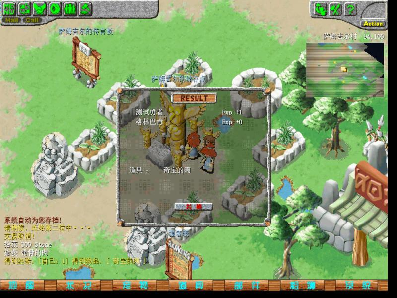

打赢按敌人等级与等级差得经验，升级每级 3 点（状态窗口里分配）、魅力 +2；战利品每场最多 3 件；回到地图后显示结果窗口（5 秒自动关）。打输 HP 留 1，不掉东西。

### 9.4 战斗设定（系统窗口 → 战斗设定）

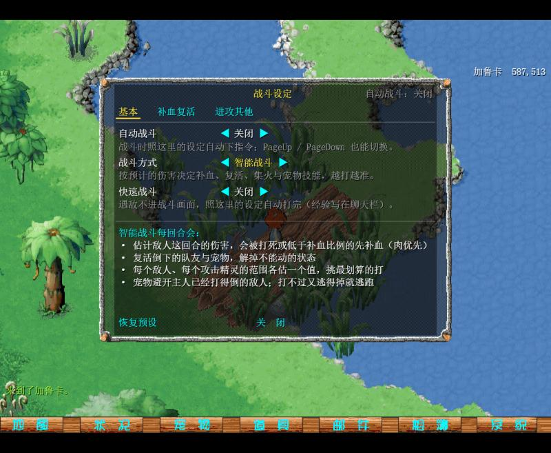

| 分页 | 项目 |
|---|---|
| 基本 | 自动战斗、快速战斗、自动遇敌、补血时机（耐久力低于 N%）、打不过就逃跑 |
| 人物 | 第一回合 / 之后每回合的行动：智能判断、普通攻击、防御、装备上的某个精灵，以及对象（自动 / 自己 / 宠物 / 敌人……）；用精灵进攻 |
| 宠物 | 出战宠物第一回合 / 之后每回合的技能（含攻击、防御）与对象 |
| 其他 | 自动抓宠、自动丢肉、恢复预设 |

- **自动战斗**（PageUp / PageDown 也能开关）：每回合由智能战斗决定人和宠物的指令——列出补血、复活、解状态、逃跑、普通攻击、各精灵与宠物技能，各估一个值挑最大的；会从战斗中学习每种敌人的威胁与自己每种行动的伤害。头目、任务战斗、决斗不逃。
- **快速战斗**：遇敌后不切到战斗画面，整场一瞬间打完，经验与战利品写在聊天栏；战斗中不能走动，自己头上照样有战斗记号。
- **自动遇敌**：在原地两格之间来回走引来敌人，配合自动 / 快速战斗就能挂机练级；手动移动、换地图或耐久力太低时自动停止。

### 9.5 组队战斗

队伍一起遇敌，我方 5 人 + 宠物，每人下指令，回合等大家都下完；道具与咒术可以对队友用。

### 9.6 求援、参战、观战

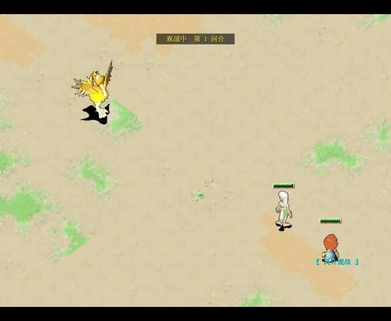

- 战斗中按"求救"，头上出现记号；别人面向求救的人按画面上方的"参战"就加入那场战斗。
- 面向正在战斗的人按"参战"而加不进去（没开求救、决斗、只能观战的楼层、自己在队伍里）就变成**观战**：看得到每回合的过程，画面上方写"观战中"，右下角"离开观战"。组队时队长按全队一起看。

### 9.7 决斗（PK）

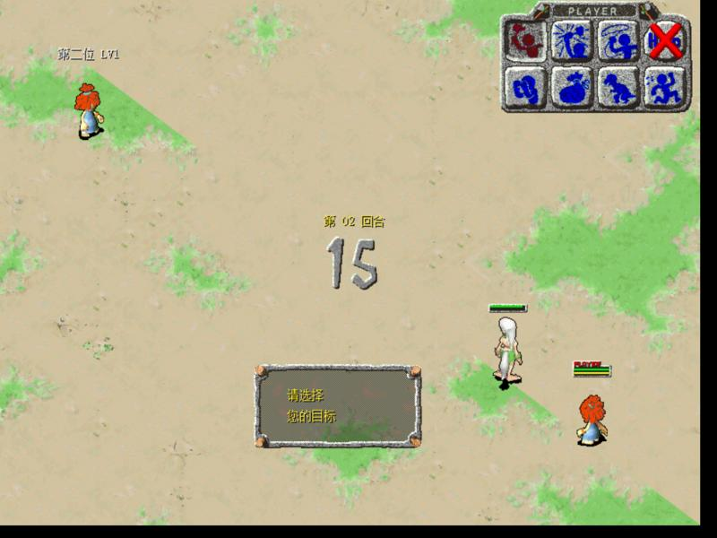

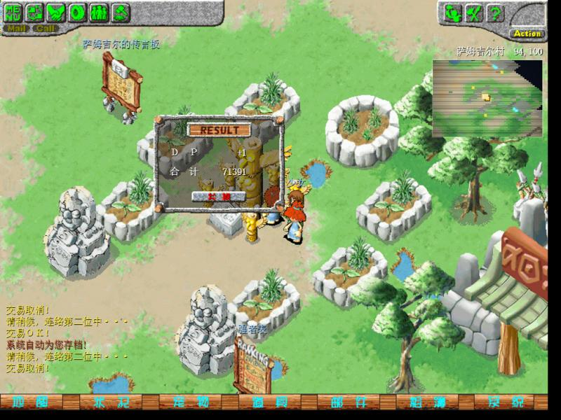

见 13.5。

### 9.8 经验共享（本作新增）

`rules.shareExp` 开着时（预设），战斗结束时还在场的人物、出战宠物、骑宠把打倒的敌人经验加起来，按三者里最低的等级折算，三者都拿这么多（不是平分）；倒下的、落马的拿不到。关掉就是原版的谁打倒谁拿（骑宠 6 成）。

---

## 10. 道具

### 10.1 道具窗口（Ctrl+I / 任务栏"道具"）

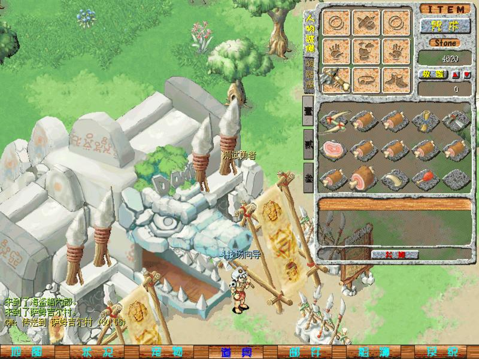

9 个装备位（头、身体、武器、两个饰品、腰带、盾、鞋、手套）+ 3 页 × 15 格。

- 点选拿起、再点放下；拖到装备栏即装备；双击使用 / 装备 / 卸下；拿着点到窗口外可以丢弃。
- 滑鼠停在道具上显示名字、耐久度、说明，以及一行青色的"实际"能力值（道具产生时各项在范围内随机）。
- 左缘的书签切到宠物页（宠物身上的 7 格道具）与"咒术"（地图上能用的精灵）。

### 10.2 装备

按道具种类决定能装的位置；等级不够不能装；拿弓时不能装盾；要职业的装备（这里没有职业系统）装不上。武器决定攻击次数与反击表。

### 10.3 使用

双击使用；目标是"其他人"的道具会打开选对象窗口（自己或宠物）。地图上能用的：回复、技能罐头、智慧之果、传送道具、飞行道具、体质道具、变身镜、鱼鳃草、改名笔、拼图等；战斗中用"道具"按钮。

### 10.4 地上的东西

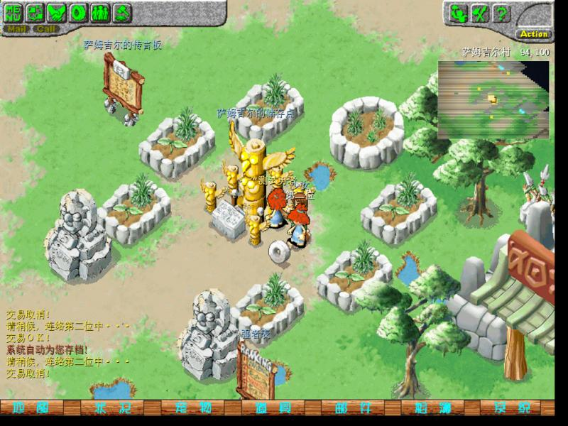

丢出的道具、石币与宠物放在身边的地上，右键点身边一格捡起。道具谁都能捡，宠物只有丢的人能捡回；道具 20 秒、宠物 30 秒、石币 30 分钟后消失（可调）。

### 10.5 耐久

每下有伤害的攻击磨损挨打者的一件防具与攻击者的武器；耐久降到 70% / 50% / 30% 以下变成受损 / 毁坏 / 不堪使用，到 0 就消失。修理用宠物技能"修复"（原版没有修理 NPC）。

### 10.6 加工、料理、精炼、修复、镶宝石、拼图

1. 在道具窗口**右键**标记要用的材料（合成 / 料理 / 精炼 / 精工 / 修复）。
2. 到宠物窗口的技能页点有那个技能的宠物的技能。
3. 宠物走过来叼走道具、转几圈后送出成品；做不出来随机还一样材料。

加工出来的道具名字是黄色的，可以用魔术笔改名。拼图：双击底板打开拼图画面，再双击拼图放进去。

---

## 11. 宠物

### 11.1 捕捉

战斗中按"捕捉"选一个敌人。抓到的宠物照抄敌人当时的数值，忠诚度最多 60。

### 11.2 宠物窗口（Ctrl+P / 任务栏"宠物"）

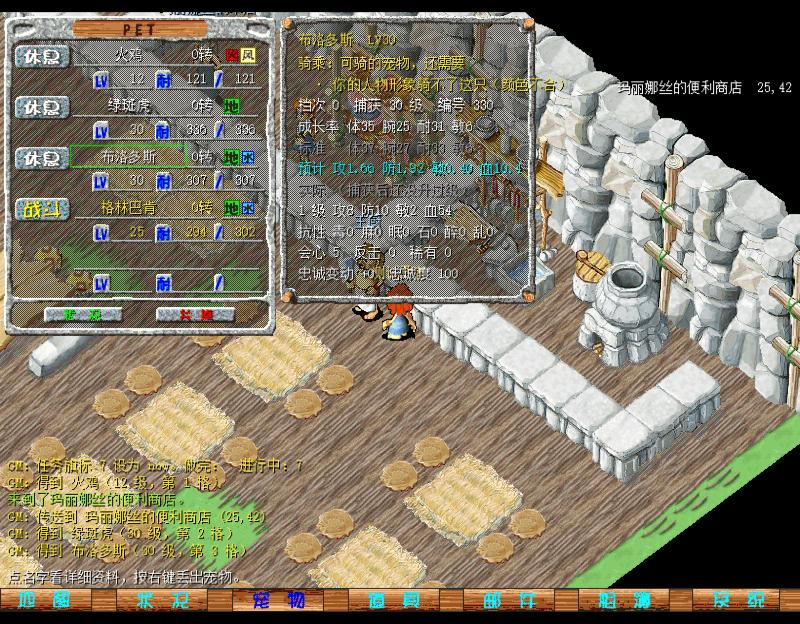

宠物栏 5 格。状态钮轮换：休息 → 待命（最多 4 只）→ 出战（1 只）→ 休息；倒下的不能出战。
一览页滑鼠停在名字上、或详细资料页，右边有**扩展资料**（本作新增）：档次、成长率、预计与实际每级成长、1 级推算值、抗性、会心 / 反击、忠诚变动值、魔法熟练度，第一行写这只能不能骑、还缺什么。

还有技能一览、改名（只有捕获的人能改）、丢出（放生）、照相（宠物图鉴，Ctrl+A）。

### 11.3 忠诚度与升级

忠诚度照原版公式（主人等级 × 魅力 / 宠物等级 / 模板值 + 变动值），升级、打倒敌人、倒下、被主人打会改变；忠诚度低时宠物会不听话（随机目标、乱用技能、攻击主人、逃走）。升级照原版：成长率 + 随机 10 点，按档次 ×4.5～6.0。倒下时原版只扣忠诚度；`rules.petDeathLoss` 设成大于 0 会再扣掉相当于升几级的成长（聊天栏会提示），决斗里倒下不扣。

### 11.4 骑宠

能骑的宠物忠诚度 100 时宠物窗口出现"骑乘"钮。条件：骑乘训练师的课程等级、宠物最多比人高 10 级、转生过的不能骑、证书骑宠要先用骑乘书学会、四色老虎按人物颜色；庄园骑宠（蓝暴 = 左迪洛斯、红暴 = 巴朵兰恩）不用加入家族，用那个庄园的骑乘书（左迪洛斯骑乘书 / 巴朵兰恩骑乘书）学会就能骑。
骑着打仗时攻防速合并、挨打分摊伤害，骑宠 HP 到 0 就落马；骑宠分到经验；回复类道具与咒术按人与骑宠各缺多少的比例分给两边。

### 11.5 宠物道具栏

道具窗口的宠物页：拖进去或双击宠物装备就装上，忠诚变动值与等级不够装不上，能力加到宠物身上。

### 11.6 宠物邮件

见 13.4。

---

## 12. 咒术（精灵）

装备着的道具带咒术。战斗中按"精灵"打开咒术窗口，按咒术的目标种类选人；地图上只有恩惠 / 滋润类的精灵能用（道具窗口的"咒术"钮）。
回复、复活、解除状态、附加状态、光 / 镜 / 守、战场属性、属性反转、魔抗 / 铁壁、攻击魔法都有；地水火风的魔法熟练度与抗魔会随使用成长。
家族的守护精灵让对应系的咒术省 3 成 MP（光明：回复类；黑暗：攻击类）。

---

## 13. 社交

### 13.1 组队

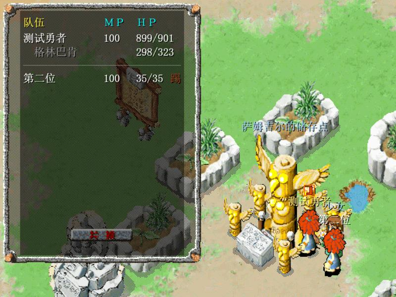

- 面前的人开着"组队"开关（Ctrl+Q 游戏设定）时按画面上方的"组队"钮就加入他的队伍，最多 5 人；再按一次离队。
- 队员跟着队长一格一格走，队长传送全队一起走；队伍频道 `[队]`。
- 状态窗口（Ctrl+S）的"队伍"钮切到队伍页：自己与宠物、每个队员的 ＭＰ / ＨＰ，队长可以踢人。
- 组队中不能用传送员、不能交易、不能摆摊。

### 13.2 交易

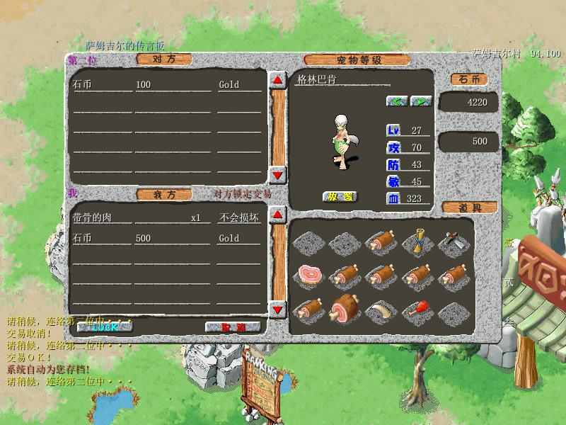

面向对方按"交易"钮或 Ctrl+T（对方要开着"交易"开关）。窗口里放道具（双击道具栏）、宠物（◀ ▶ 选、"放"）、石币（输入或 + −），两边"锁定"后变成"确定"，都按确定才换。交易中不能走、不能丢东西、不能用道具；下线、开打、被传走时交易取消。交易中双方头上有〔交易中〕。

### 13.3 摆摊

把道具或宠物标价摆在地上卖给别的玩家。只做石币摊位。

**摆摊**

1. 站在空地（面前没有人，脚下也没有别人在摆摊），按画面上方的**摆摊**钮，打开设定窗口。
2. 上面填摊位名称（最多 8 个中文字，空白就是"欢迎光临!!"）；清单列出道具栏的道具与宠物栏的宠物，点一行加进贩卖清单并在右边填价钱（石币），再点一次取消；最多 20 项。
3. 按"开张"。头上出现招牌（写着摊位名）与货摊，摆着的时候不能走动。
4. 再按一次摆摊钮：收起来改内容（有人正在看会通知他"店家取消交易"）；改完按"开张"重新摆，或按"取消"收摊。
5. 登出、被传送、开打都会自动收摊。

不能卖的东西：登出会消失的道具（门票类）、家族守护兽、骑着的宠物、送信中的宠物。卖出时按 `rules.vendorTax` 抽税（预设 0）。

**买东西**

1. 面向摆摊的人（走到旁边、用右键转身面向他），按摆摊钮，打开他的清单；这时双方头上都有〔交易中〕，一个摊位同时只能有一个人看。
2. 点一行勾选（可以多项），"详情"看那一项的说明（道具的耐久、能力、咒术；宠物的等级、忠诚、攻防敏、属性）。下面显示合计与自己身上的石币。
3. 按"购买"：钱直接付给店家，东西放进自己的道具栏 / 宠物栏；钱不够、店家放不下石币、道具栏或宠物栏满了会停下，前面买到的算数。
4. 按"离开"（或 Esc）关掉窗口。

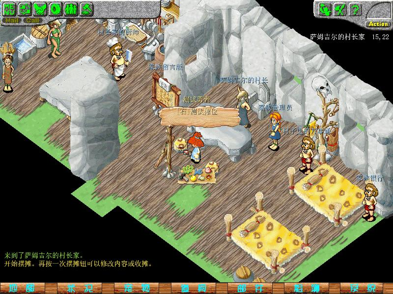

### 13.4 名片与邮件（Ctrl+E / 任务栏"邮件"）

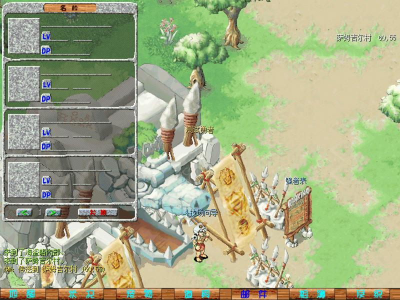

- 面向对方按"名片"钮交换名片（最多 80 张），名片上看得到对方是否在线。
- 写信：对方不在线时存起来，上线时收到（保留 3 天）；新邮件时左上角的灯会闪。
- 宠物邮件：把"邮件"状态的宠物派出去送信，可以带一件道具，按宠物的敏捷算飞行时间。邮件历史存在浏览器里。

### 13.5 决斗

面前的人开着"决斗"开关时按"决斗"钮就开打，两边的队伍一起进来。逃跑一定成功、不能捕获、复活不能用在玩家身上；没有经验与掉落，改算 DP：倒下扣 10% 给打倒他的人、逃跑扣 20%。打完显示 DP 结果窗口；强者表 NPC 看排名。决斗中下线也照逃跑扣 DP。

### 13.6 动作

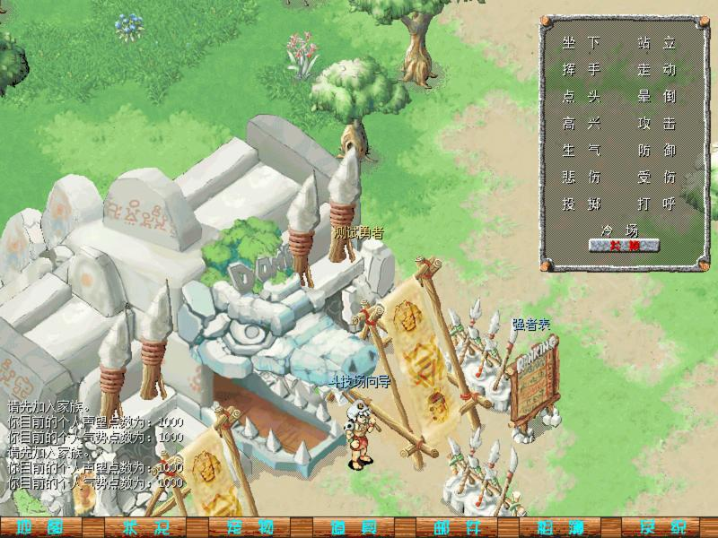

Ctrl+W 打开动作窗口，或用 Ctrl+数字（见 5.3）：坐下、挥手、高兴、生气、悲伤、晕倒、打呼、冷场等 15 种。

---

## 14. 家族与庄园

家族资料所有线路共用。

### 14.1 成立与加入

- **成立**：找家族管理员（四个村庄）。条件：30 级或转生过、做过成人礼、10000 石币（可调）；选守护精灵（光明 / 黑暗）与守护兽（自己的一只宠物，之后不能丢、不能交易、不能寄宠物邮件、不能改名、不能寄放）。正式族人满 5 人算正式成立。
- **加入**：找家族管理员申请，族长或长老审核。一个家族最多 50 人、长老最多 5 人。
- 别的玩家头上会显示家族名。

### 14.2 家族选单（画面上方的"家族"钮）

家族资料、族长功能（族长广播、成员管理、邀请函 / 骑乘同意书、族长让位）、家族布告栏、关闭广播；族员可以退出，族长可以解散。

### 14.3 布告栏（也可以找家族留言版 NPC）

成员列表（职位、是否继续召募）、家族留言、家族之间留言板（族长才能写）、申请家族据点、家族之间强者表（三十大、冒险、饲育、战斗、气势……）、庄园占据时间表。

### 14.4 声望、气势与银行

- 第一次做完任务得到冒险声望，宠物 31 级以上升级得到饲育声望，都算进个人声望与家族气势。
- 家族银行 NPC：个人帐户（存在角色上，退出家族后还能领）与共同帐户（长老、族长才能领）。

### 14.5 庄园与庄园争夺战

- 4 个庄园。声望 1000、正式族人 10 人的家族族长可以向秘书申请空的庄园；族人可以进庄园的族长家与专属店，秘书做邀请函与骑乘同意书，家族小护士免费回复，庄园所属村子里买东西时主人家族另外得到 10% 的税。
- **庄园争夺战**：没有庄园的家族族长找庄园的踢馆登记人下战书，定在明天 20 / 21 / 22 点；到时间由对战向导进场，准备时间后开战，两边在场上面对面就能决斗；倒下 / 逃跑的人被服务员送出场；一边没人或整点 59 分判胜，客队赢就接管庄园。召唤员可以把在线族人叫过来。
- **家族 PK 场**：场地预约人预约之后的整点、挑对手与规则（生存战 / 打飞战），对方族长接受后照上面的流程打；赢家拿输家十分之一的声望。

---

## 15. 任务

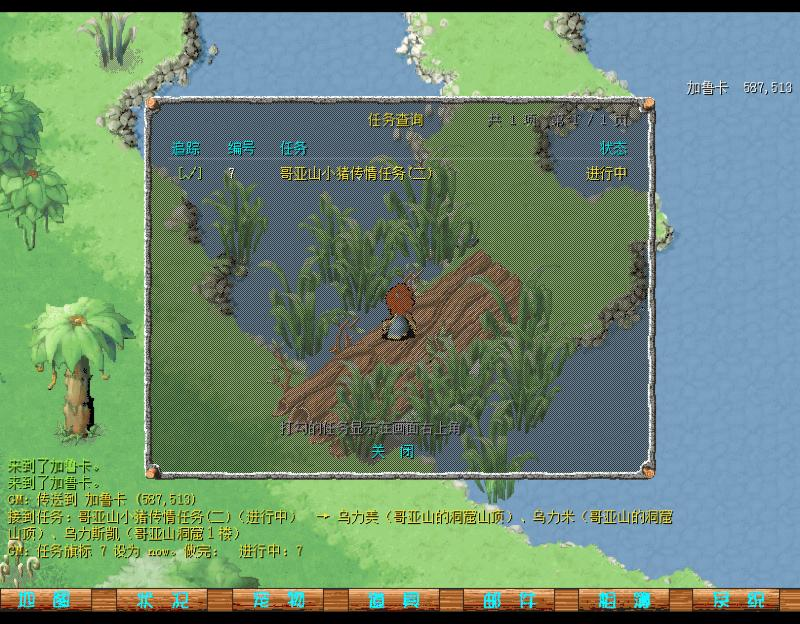

画面上方的"任务查询"钮打开任务窗口：每页 10 项，列出进行中与已完成的任务（原版 jobdaily.txt 的清单，加上用道具记进度的 JOT 巡回全岛），每项附"找哪个 NPC、在哪一层"的提示。

另一页"可接任务"列出现在就能去接的委托（条件已经符合、还没接也还没做完的），一样附上找谁、在哪一层。

- 打勾的任务显示在地图画面右上角（楼层名下面，最多 4 项）。
- 接到新任务时聊天栏提示并自动追踪；完成时提示后取消追踪。追踪的编号存在浏览器里。

任务本身由任务交换 NPC 推进：接任务（REQUEST）、交任务（ACCEPT）、说明、清除；要交出 / 拿到道具、石币、魅力，有的要对着 NPC 说关键字，有的 NPC 完成后会换位置。

---

## 16. 交通：长毛象巴士与加美航空

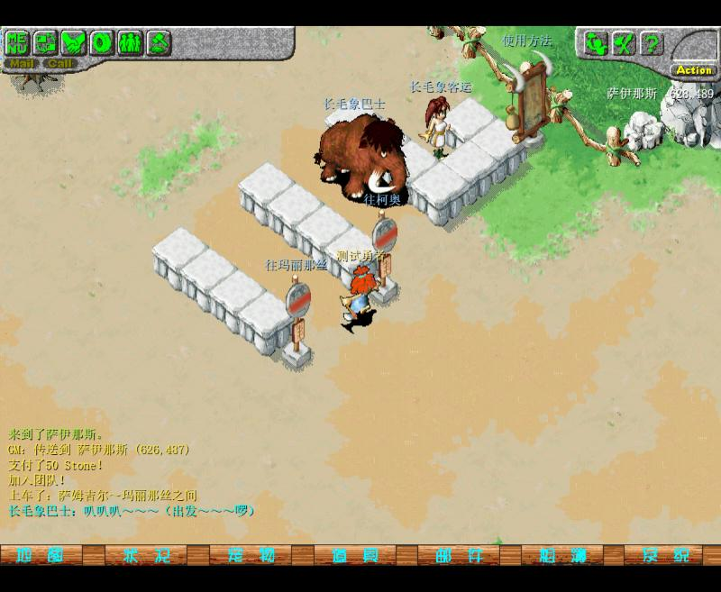

（伊甸大陆、动物园、尼克斯水城、库沙达洞窟、海盗船等区域的 NPC、地图、传送点、遇敌、敌人与道具来自石器 8.0 的服务端数据，补在 gamedata 各文件末尾与 npc/add80、map/add80；私服自加的内容（魔王楼、点卷 PK 场、VIP 道具等）没有收。）

- 面向停着的巴士（或飞机）说话、或按画面上方的"组队"钮，就付车资上车（成为它的队伍成员）；行驶中不能上，等级不够、带着禁止的道具也不能上。玛丽娜丝港口那个叫"加美航空"的女向导不是飞机，飞机停在旁边的 (105,87)。
- 巴士沿路线连续走动，乘客跟着走（速度由 `rules.busStep` 调）；飞机会换楼层。奇努伊～米兰达这条航线原版数据里没有飞机（只有站牌），这里补上了。路线是开机算好的固定路径（站点之间直线相连，照原版不看通行），不会在桥头打转。
- 到站 3 秒后解散队伍，巴士随机换路线掉头，等一段时间再开；乘客再对它说话可以提早出发。

---

## 17. 设定与存档

### 17.1 系统窗口（Esc / 任务栏"系统"）

另有"经验显示 / 经验关闭"：打完一场要不要在聊天栏写得到的经验与物品。

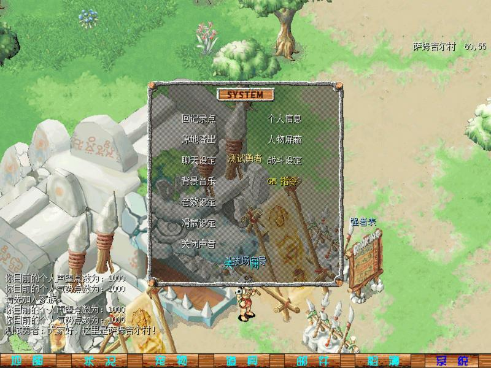

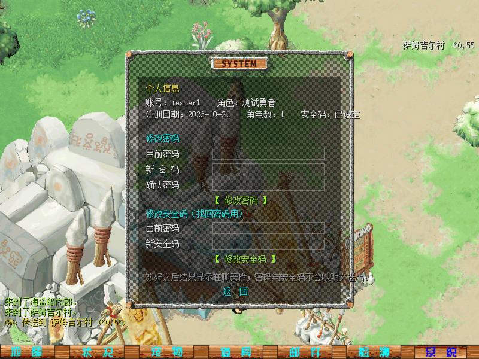

回记录点、原地登出（回角色选择）、聊天设定（显示行数、文字颜色、音量）、背景音乐与音效（音量、每首各自的节奏、立体声 / 单声道）、滑鼠设定（原版光标 / 系统光标）、关闭声音、个人信息、人物屏蔽（不画别的玩家）、战斗设定（见 9.4），GM 另有"GM 指令"选单。

**个人信息**：账号名、注册日期、角色数、有没有设安全码；下面可以**修改密码**（填目前密码、新密码两次）和**修改安全码**（填目前密码、新安全码）。改密码 / 改安全码都要先验目前的密码，连错 5 次会暂时锁住；结果显示在聊天栏。

### 17.2 游戏设定（Ctrl+Q）

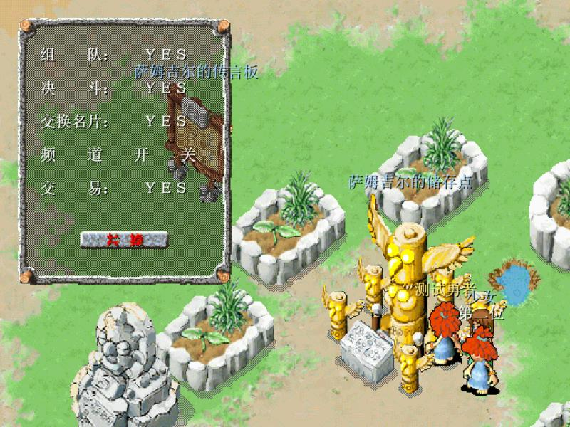

组队、决斗、名片、交易、频道的开关：关着时别人不能对你提出组队 / 决斗 / 交换名片 / 交易。

### 17.3 什么存在哪里

| 存在服务端（跟着角色走） | 存在浏览器（localStorage，换浏览器就没了） |
|---|---|
| 角色、等级、道具、宠物、石币、声望、任务旗标、记录点、名片、离线邮件、家族 | 聊天 / 音效 / 滑鼠设定、战斗设定与战斗中记住的按钮、智能战斗学到的东西、看过的地图格子与去过的楼层、邮件历史、宠物图鉴、任务追踪、GM 指令记录 |

下线时会完整存档一次；登出会消失的道具（门票类）下线时消失。

### 17.4 声音

浏览器要等第一次点击或按键才能出声。背景音乐按地图上的记号换曲，战斗、头目、抓到宠物各有音乐；环境音随时段变化；可以在系统窗口里调音量、节奏或关掉。

---

## 18. GM 指令

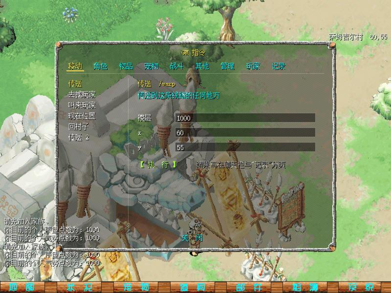

`config.yaml` 的 `gms` 里的账号登录后，系统窗口多一个"GM 指令"选单（分页、每个参数有输入方式、清单可以挑），在聊天栏打指令也一样。别人看不到选单、打了也不执行。每个指令都回一句，参数不对回用法。
"玩家"分页列出这条线路上的在线玩家，点一个就看到账号、位置、HP、宠物、禁言状态，旁边的按钮可以查看、去找、叫来、踢下线、禁言 / 解除、给道具、改密码、改安全码；"记录"分页是执行过的指令与回应。

| 分类 | 指令 |
|---|---|
| 移动 | `/warp 楼层 x y`、`/goto 名字`、`/call 名字`、`/where`、`/town 萨姆吉尔\|玛丽娜丝\|加加\|卡鲁它那`、`/town2 村庄`（传送到任一村庄的复活点，含没有记录点的村 / 城，共 33 处；GM 窗口里从清单选、可翻页，不带参数会列出全部村庄） |
| 角色 | `/lv 等级`、`/exp 经验`、`/points 点数`、`/stat 体 腕 耐 敏`、`/attr 地 水 火 风`、`/charm 魅力`、`/dp 数值`、`/trans 次数`、`/luck 1..5`、`/hp`、`/mp`、`/heal` |
| 物品 | `/item 编号 [个数]`、`/gold 数量`、`/fame 数值`、`/give 名字 编号 [个数]`、`/repair`、`/bank 金额`、`/clearbag 确定` |
| 宠物 | `/pet 敌人编号 [等级]`、`/petlv 格位 等级`、`/petai 格位 [变动值]`、`/petskill 格位 技能栏 技能编号`、`/petname 格位 名字`、`/petrank 格位 0..5`、`/petdel 格位`、`/learnride 等级`（格位从 0 起） |
| 战斗 | `/encount [敌人编号 [等级]]`（不填按遇敌区域；填了就和那种敌人单挑）、`/noenc` |
| 其他 | `/event 编号 [done\|now\|clear]`（任务旗标）、`/fm fame\|fill\|manor\|gold 数值`（家族测试资料）、`/war 对战场 prepare\|fight\|end\|clear\|show`（庄园争夺战 / 家族 PK 场拨阶段） |
| 管理 | `/who`、`/look 名字`、`/mute 名字 分钟`（0 解除）、`/announce 内容`、`/kick 名字`、`/setpw 名字 新密码`、`/setsecret 名字 安全码`（替在线玩家改账号的密码 / 安全码，给忘了安全码的人用） |

---

## 19. 与原版不同的地方与常见问题

### 19.1 本作新增或改动的

- 浏览器即开即玩、登录页直接注册、任务栏常驻、画面等比缩放与高分屏清晰。
- 世界地图取代原版 54×54 格的自动地图。
- 升级加点可以按住连续加；道具说明多一行实际能力值；宠物扩展资料；任务追踪与提示。
- 经验共享、自动遇敌、快速战斗、智能战斗（取代原版的 AI 模式）。
- 一个进程多条线路，家族所有线路共用。
- 丢出的道具放在地上（原版这台服务端缺脚本，会直接消失）。
- 敌人头上常显名字与等级；交易与摆摊的双方头上有〔交易中〕。

### 19.2 没有做的

家族徽章（图不在资源里）、称号（私服道具已移除）、聊天设定的快捷语、决斗胜败连胜的计数、私服的充值 / 卡密 / VIP 道具、原版没有登记函数的少数宠物技能、摆摊的声望 / 积分摊位。

### 19.3 常见问题

- **没有声音**：先在页面上点一下或按个键；Safari 有些版本放不了 Opus。
- **画面糊**：浏览器缩放设回 100%，画面会按屏幕像素渲染。
- **登录一直失败被锁**：连续失败 5 次锁 1 分钟，之后加倍；等一下再试。
- **角色被踢下线**：同一角色在别处登录了（顶号）。
- **地图是黑的**：只画走过看过的格子；换浏览器或清了网站资料就要重新探索。
- **摆摊钮没反应**：组队中、交易中、战斗中不能摆；脚下有人在摆会提示；面前的人没摆摊时按钮是打开自己的设定窗口。
- **走不动**：摆着摊、看着别人的摊位、交易中、观战中、当队员时都不能自己走。
- **传送员说"组队中不能使用"**：先离队。
- **删库重来**：停掉服务端，删 `bin/saserver.db`，再启动；`gms` 里的账号名会保留给管理员重新注册。

---

## 20. 开发者附录

- 目录结构、常用命令、协议与测试见 `README.md`（GitHub 说明）与 `CLAUDE.md`（完整的实现笔记、与原版的差异、资源格式规格）。
- 协议只定义在 `proto/messages.json`，改了之后在 `server/` 下 `go run ./tools/protogen` 重新生成两端代码。
- 改了 `client/src` 后 `node client/build.mjs`；改了客户端用到的界面图号后 `go run ./tools/assetindex` 重建资源索引。
- 服务端测试：`cd server && go test ./...`（用真实的 gamedata）。
- 浏览器调试：网址加 `?debug`（帧率、每帧耗时、SA 时间、近 2 分钟的消息数与流量）或 `?hits`（画出所有热区）；页面上的 `globalThis.sa` 是调试入口。
